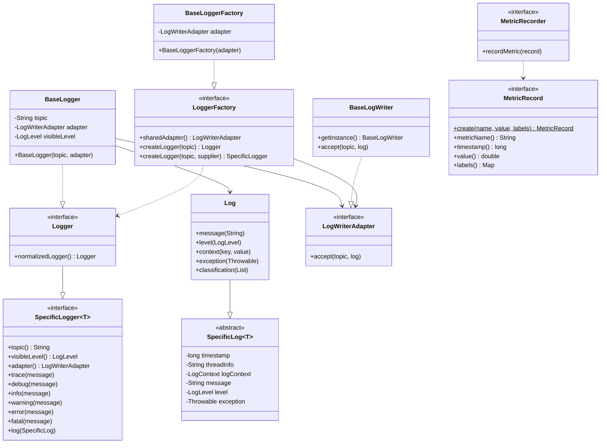

# Keel Logger API

Keel Logger API 是一个灵活且可扩展的 Java 日志 SDK，旨在提供结构化、上下文感知的日志记录能力和定量指标记录功能。

## 项目信息

- **版本**: 
- **Java 版本**: 17+
- **构建工具**: Gradle
- **许可证**: **GPL-3.0-only** 与 **LGPL-3.0-only** 并行（任选其一），见仓库根目录 [`LICENSE`](LICENSE)
- **仓库地址**: [https://github.com/sinri/keel-logger-api](https://github.com/sinri/keel-logger-api)
- **Maven 坐标**: `io.github.sinri:keel-logger-api:5.0.3`

## 核心特性

- ✨ **结构化日志** - 支持消息、上下文、异常、分类等结构化信息
- 📊 **多级别日志** - 8 个日志级别（TRACE、DEBUG、INFO、NOTICE、WARNING、ERROR、FATAL、SILENT）；过滤与比较依据 `severity()`（`100`～
  `700` 步长 `100`，`SILENT` 为 `Integer.MAX_VALUE`），详见 `docs/5.0.3/概述与设计.md` §3.1
- 🔌 **适配器模式** - 通过 `LogWriterAdapter` 自定义日志输出方式
- 🏭 **工厂模式** - 通过 `LoggerFactory` 统一创建和管理 Logger 实例
- 🔧 **高度扩展** - 支持自定义 `SpecificLog` 和 `SpecificLogger`
- ⚡ **性能优化** - 日志级别前置检查，避免不必要的对象创建
- 📈 **指标记录** - 内置 `MetricRecorder` 接口用于定量指标和时序数据记录

## 文档与使用说明

用法、依赖坐标与代码示例不在本文件中重复，请直接阅读版本化文档：

- **文档索引**：[docs/5.0.3/README.md](docs/5.0.3/README.md)
- **入门与日常 API**：[docs/5.0.3/使用者指南.md](docs/5.0.3/使用者指南.md)
- **适配器、渲染、自定义日志类型与全局工厂**：[docs/5.0.3/扩展与集成.md](docs/5.0.3/扩展与集成.md)
- **模块边界与设计细节**：[docs/5.0.3/概述与设计.md](docs/5.0.3/概述与设计.md)
- **面向 AI / 自动化工具的集成约束**：[docs/5.0.3/AI集成指南.md](docs/5.0.3/AI集成指南.md)

## 开发要约

### 构建项目

```bash
./gradlew build
```

### 运行测试

```bash
./gradlew test
```

### 生成 JavaDoc

```bash
./gradlew javadoc
```

生成的文档位于 `build/docs/javadoc/` 目录。

### 发布到仓库

项目根据版本号自动选择发布目标：

- **SNAPSHOT 版本**或**带字母后缀的版本**（如 `5.0.3-SNAPSHOT` 或 `5.0.3-rc.1`）将发布到内部 Nexus
- **正式版本**（如 `5.0.3`）将发布到 Maven Central（通过 Sonatype Central Portal 的兼容 Staging API）

**发布命令**:

```bash
./gradlew publish
```

> **注意**:
> - 发布需要配置相应的认证凭据
> - 内部 Nexus 需要配置: `internalNexusUsername`, `internalNexusPassword`, `internalNexusSnapshotsUrl`, `internalNexusReleasesUrl`
> - Maven Central（Sonatype Central Portal）需要在 `~/.gradle/gradle.properties` 中配置: `sonatypeUsername`, `sonatypePassword`
> - 正式版本发布时会自动进行 GPG 签名

如需显式执行“发布到 Central + 自动 close + release”，可以使用插件提供的任务组合：

```bash
./gradlew publishToSonatype closeAndReleaseSonatypeStagingRepository
```

如遇到任务名差异（`...Repository` / `...Repositories`），可先查看 publishing 分组下的任务列表：

```bash
./gradlew tasks --group=publishing
```

## 架构说明



### 设计模式

- **适配器模式**: `LogWriterAdapter` 允许自定义日志输出方式（控制台、文件、数据库、远程服务等）
- **工厂模式**: `LoggerFactory` 统一创建和管理 Logger 实例，共享适配器
- **构建器模式**: 通过 Consumer 函数式接口构建复杂的日志对象
- **模板方法**: `SpecificLog` 和 `SpecificLogger` 提供扩展点

## 许可证

本软件在 **GPL-3.0-only** 与 **LGPL-3.0-only** 下**并行**许可：你可**任选其一**适用（非同时叠加两套义务）。全文见：

- [GNU General Public License v3.0](https://www.gnu.org/licenses/gpl-3.0.txt)
- [GNU Lesser General Public License v3.0](https://www.gnu.org/licenses/lgpl-3.0.txt)

仓库根目录 [`LICENSE`](LICENSE) 含 SPDX 标识行，发布至 Maven 的 POM 中亦列出上述两项许可。

## 贡献者

- [Sinri Edogawa](mailto:e.joshua.s.e@gmail.com)

---

**相关资源**:

- [JavaDoc 文档](https://sinri.github.io/keel-logger-api/)
- [GitHub Issues](https://github.com/sinri/keel-logger-api/issues)
- [更新日志](https://github.com/sinri/keel-logger-api/releases)
