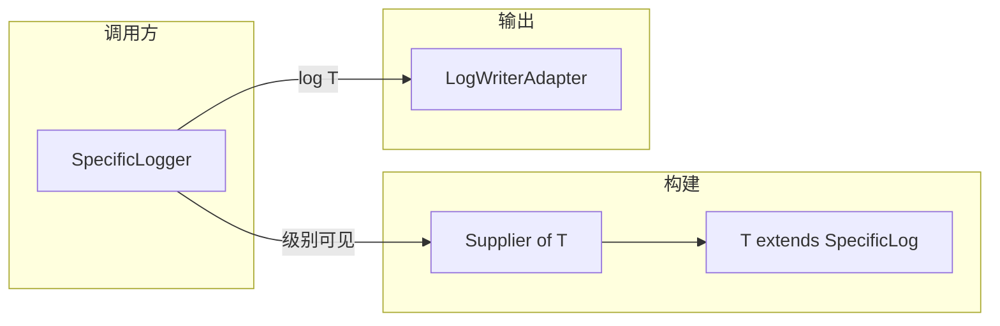

# 概述与设计

## 1. 库的定位

Keel Logger API 是一套 **与具体输出介质无关** 的日志与指标抽象：

- **日志**：以「主题（topic）+ 结构化记录（`SpecificLog`）」为模型，经 `LogWriterAdapter` 输出。
- **指标**：以 `MetricRecord`（名称、数值、时间戳、标签）描述数据点，经 `MetricRecorder` 输出。

本库 **不包含** SLF4J/Log4j 绑定，也不强制 JSON 序列化格式；默认仅提供将日志渲染为可读文本并打印到标准输出的
`BaseLogWriter`。

## 2. Java 模块与导出包

模块 `io.github.sinri.keel.logger.api` 导出以下包：

| 包                                         | 职责                                                                   |
|-------------------------------------------|----------------------------------------------------------------------|
| `io.github.sinri.keel.logger.api`         | `LogLevel`、`LoggingStackSpecification`、`LateObject` 等公共类型            |
| `io.github.sinri.keel.logger.api.logger`  | `Logger`、`SpecificLogger`、基础实现与 `SilentLogger`                       |
| `io.github.sinri.keel.logger.api.log`     | `Log`、`SpecificLog`、`LogContext`                                     |
| `io.github.sinri.keel.logger.api.adapter` | `LogWriterAdapter`、`BaseLogWriter`、`SilentLogWriter`、`LogTextRender` |
| `io.github.sinri.keel.logger.api.factory` | `LoggerFactory`、`BaseLoggerFactory`、`SilentLoggerFactory`            |
| `io.github.sinri.keel.logger.api.metric`  | `MetricRecord`、`MetricRecorder`                                      |

未导出的类型（如 `ThrowableRender`、`MetricRecordImpl`、`SharedLoggerFactoryHolder`）属于实现细节，不应在模块边界外引用。

## 3. 核心概念

### 3.1 日志级别 `LogLevel`

严重度自低到高：`TRACE` → `DEBUG` → `INFO` → `NOTICE` → `WARNING` → `ERROR` → `FATAL` → `SILENT`，由
`severity()` 决定（与枚举声明顺序无关）。

| 常量        | `severity()`                      |
|-----------|-----------------------------------|
| `TRACE`   | `100`                             |
| `DEBUG`   | `200`                             |
| `INFO`    | `300`                             |
| `NOTICE`  | `400`                             |
| `WARNING` | `500`                             |
| `ERROR`   | `600`                             |
| `FATAL`   | `700`                             |
| `SILENT`  | `Integer.MAX_VALUE`（`2147483647`） |

- `isEnoughSeriousAs(standard)` / `isNegligibleThan(standard)` 基于上表数值比较（非 `ordinal()`）。在相邻两档之间可选用未占用的整数作为新级别的
  `severity`（例如在 `200` 与 `300` 之间插入 `250`）。
- **`SILENT`**：表示「不记录」；`SpecificLogger` 在 `visibleLevel() == SILENT` 时直接丢弃日志（不调用适配器）。其
  `severity()` 取最大整型，故不存在「比 SILENT 更严重」的常规比较结果；若将来需要「重于 `FATAL` 但仍可输出」的级别，可使用
  `701`～`Integer.MAX_VALUE - 1` 区间的数值（当前枚举未定义此类常量）。

### 3.2 日志记录 `SpecificLog` 与 `Log`

`SpecificLog<T>` 承载一次记录的 **标准字段**：

- 时间戳、线程信息（构造时捕获）
- 级别、消息、异常、分类（`List<String>`）
- `LogContext`：键值上下文，底层为有序 `TreeMap`，便于稳定输出
- `extra`：`TreeMap<String, Object>`，子类可通过 `protected extra(key, value)` 扩展

`Log` 是不附加业务字段的 `SpecificLog<Log>`，即通用日志类型。

### 3.3 日志记录器 `SpecificLogger` 与 `Logger`

- `SpecificLogger<T>`：针对某一 `topic` 与 `LogWriterAdapter`，用 `Supplier<T>` 创建具体日志类型实例。
- **级别前置检查**：`trace`/`debug`/… 等默认实现先判断当前级别是否「可见」，再 `get()` 日志对象并组装，减少无效分配。
- `Logger` 继承 `SpecificLogger<Log>`，仅增加 `normalizedLogger()` 默认返回自身。

`BaseLogger`：`topic` + `LogWriterAdapter`，`specificLogSupplier` 固定为 `Log::new`，默认可见级别 `INFO`，未指定适配器时使用
`BaseLogWriter.getInstance()`。

`BaseSpecificLogger<T>`：自定义 `Supplier<T>` 与共享适配器；`normalizedLogger()` 懒创建同 topic、同适配器、同级别同步的
`BaseLogger`（见 `LateObject`），便于在需要 `Logger` 类型的 API 间传递。

### 3.4 写入适配器 `LogWriterAdapter`

函数式契约：`void accept(String topic, SpecificLog<?> log)`。

实现负责 **持久化、转发、格式化** 等；本库默认实现 `BaseLogWriter` 使用 `LogTextRender.render` 生成字符串后
`System.out.println`。

### 3.5 工厂 `LoggerFactory`

- `createLogger(String)` / `createLogger(Class<?>)` → `Logger`（`Log`）。
- `createLogger(String, Supplier<L>)` → `SpecificLogger<L>`。
- **全局共享工厂**：`LoggerFactory.getShared()` / `replaceShared(LoggerFactory)`，由 `SharedLoggerFactoryHolder` 持有
  `AtomicReference`，默认 `BaseLoggerFactory`。

### 3.6 指标 `MetricRecord` / `MetricRecorder`

- `MetricRecord.create(...)` 工厂方法构造默认实现（包内 `MetricRecordImpl`），标签为可变 `HashMap` 拷贝。
- `MetricRecorder` 仅 `recordMetric(MetricRecord)`，与日志管道独立，由集成方实现对接 Prometheus、时序库等。

## 4. 请求路径（从调用到输出）

1. 调用方调用 `info(...)` 等；若级别低于 `visibleLevel()` 或为 `SILENT`，直接返回。
2. 否则创建 `T`，填充 message/context/exception 等。
3. `log(T)` 再次校验级别后调用 `adapter().accept(topic, log)`。

## 5. 沉默相关两种形态

| 机制                                        | 行为                                                                                                          |
|-------------------------------------------|-------------------------------------------------------------------------------------------------------------|
| `SilentLogger`                            | `visibleLevel()` 恒为 `SILENT`；`visibleLevel(LogLevel)` 抛异常；所有级别在前置检查处短路，不构造日志对象、不调用用户 `Consumer`（与级别检查一致）。 |
| `SilentLoggerFactory` + `SilentLogWriter` | `createLogger(topic)` 返回 `SilentLogger`；`createLogger(topic, supplier)` 返回 `BaseSpecificLogger` 并置 `visibleLevel(SILENT)`。两者均在前置检查处短路、零分配，适配器 `accept` 永不被调用。 |

测试、占位或「全链路无输出」时按需选用；`SilentLogger` 不可改级别，`BaseSpecificLogger` 路径仍可改级别（改回非 `SILENT`
后即恢复"构造后交给空适配器"的旧语义）。若确需"调用路径存在但写入为空且不短路"，应自行
`new BaseLogger(topic, SilentLogWriter.getInstance())`。

> 5.0.2 及之前：`SilentLoggerFactory` 创建的是普通 `BaseLogger` / `BaseSpecificLogger`（默认 `visibleLevel = INFO`），
> `INFO` 及以上仍会构造日志对象再交给空适配器；5.0.3 已修正为真正沉默。

## 6. 异常堆栈渲染

`BaseLogWriter` 实现的 `LogTextRender` 在渲染 `throwable` 时委托 `ThrowableRender.renderThrowableChain`，默认使用
`LoggingStackSpecification.IgnorableCallStackPackageSet` 对 **包名前缀匹配
** 的栈帧进行折叠，减少 Vert.x / Netty 等框架层帧对阅读的干扰。该 `Set` 为 **可变静态集合**，集成方可在启动时增删前缀。
